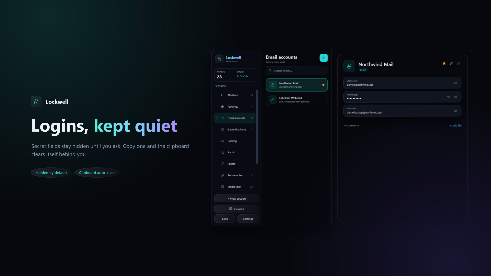
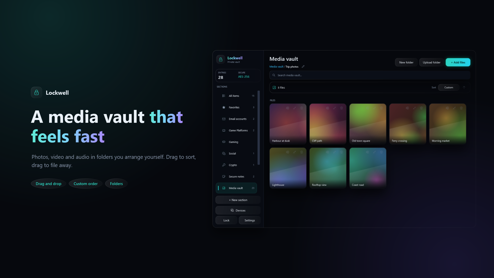
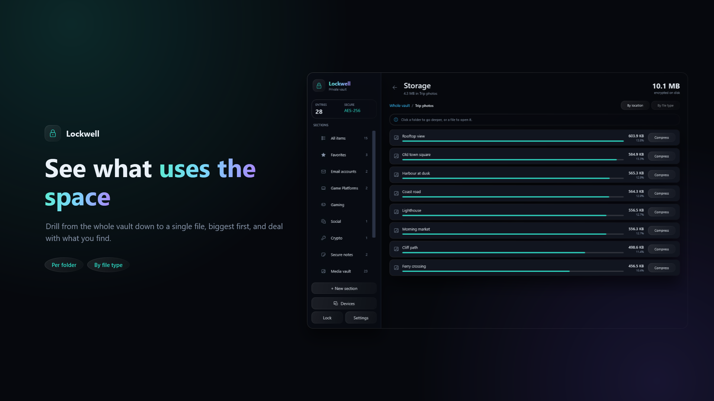
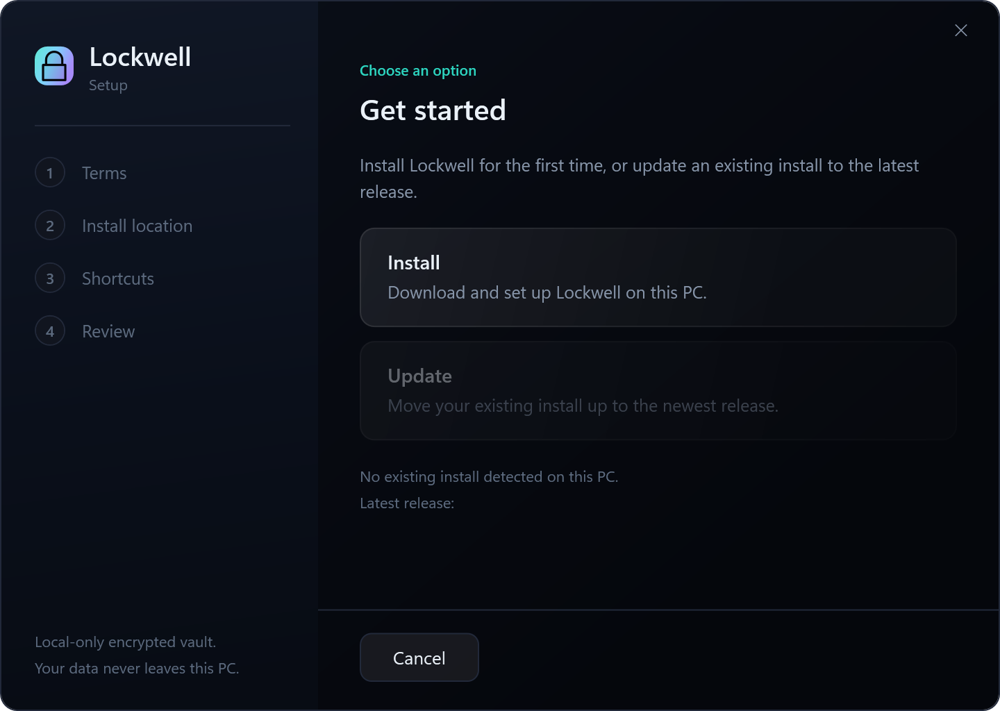

<p align="center">
  
</p>

<p align="center">
  <a href="https://github.com/slashneck/Lockwell/releases/latest"></a>
  <a href="https://github.com/slashneck/Lockwell/releases"></a>
  
  <a href="LICENSE"></a>
</p>

<p align="center">
  <a href="https://github.com/slashneck/Lockwell/releases/latest"><b>Download for Windows</b></a>
  &nbsp;&nbsp;|&nbsp;&nbsp;
  <a href="#features">Features</a>
  &nbsp;&nbsp;|&nbsp;&nbsp;
  <a href="#security">Security</a>
  &nbsp;&nbsp;|&nbsp;&nbsp;
  <a href="#building">Build it yourself</a>
</p>

<br>

Lockwell keeps your passwords, notes, keys and private files behind one master password, in an encrypted vault on your
own PC. There is no account and no server, so there is nothing to breach and nobody who can reset your password for you.
Forget your master password and your recovery key, and the data is gone.

<p align="center">
  
</p>

<p align="center">
  
</p>

<p align="center">
  
</p>

<p align="center">
  <sub>Screenshots are from version 1.2. The app looks different now.</sub>
</p>

## Features

**Encrypted at rest.** Argon2id (256 MiB) derives the key from your master password. AES-256-GCM encrypts the contents
and detects tampering.

**Passwords, notes and any file.** Logins, keys and notes sit next to photos, video, audio and documents, even a project
RAR. Click a field to copy it, and the clipboard clears itself.

**Find anything.** Ctrl K searches items, files, folders, sections and commands from one box. Secret fields and notes are
never searched, and neither is anything inside a hidden NSFW folder.

**Files.** Folders, a grid or a list, and Ctrl-click to move, export or delete several at once. Photos and GIFs are
decrypted in memory and never written to disk. Videos play right in the app, and while one plays a decrypted copy sits in
a temp folder. A storage breakdown shows what is using space, and built-in compression can shrink photos, audio and video
using the encoders already on your PC.

**Yours to move.** Encrypted backups, exporting whole folders, and moving the whole vault to another drive like a USB
stick. Separate profiles get separate vaults with their own passwords.

**Locks itself.** Auto-lock when idle or minimized. Optional exclusion from OBS and similar tools, and a warning before
you type your password if a recorder is already running.

**Android companion.** Early, and it lives in this repository too. It holds only the items you send to it, never a mirror
of your vault. Pairing happens over your local network.

## Install

Download `LockwellSetup.exe` from the [latest release](https://github.com/slashneck/Lockwell/releases/latest) and run it.
It installs to Program Files, so Windows asks for admin rights. The app itself runs without them.

The setup isn't code signed yet, so Windows SmartScreen may say it "protected your PC". Click **More info** and then
**Run anyway**. Every release is signed with Lockwell's own key, and both the setup and the app check that signature
before anything is written.

<p align="center">
  
</p>

You need Windows 10 (version 2004 or newer) or Windows 11, 64 bit.

Your vault lives in `%LocalAppData%\Lockwell`, or on the drive you moved it to. Updates only replace program files.

**Write down the recovery key.** It is the only other way into your vault, and it is shown once.

## Security

The [threat model](docs/THREAT-MODEL.md) says what Lockwell protects against and what it can't: keyloggers, malware on an
unlocked PC, decrypted video in the temp folder while it plays, and why overwriting a file on an SSD is weaker than it
sounds. The file layout is in [the vault format](docs/VAULT-FORMAT.md).

Lockwell uses the network for two things: an update check you can turn off, and sending items to a device you linked
yourself over your local network. There is no telemetry.

Found a security problem? Please [report it privately](https://github.com/slashneck/Lockwell/security/advisories/new)
instead of opening a public issue.

## Building

You need the .NET 8 SDK. The Android app also needs the MAUI workload.

```powershell
dotnet build Lockwell/Lockwell.csproj -c Release
```

To run the checks, which cover the vault, the encryption, old vaults still opening and the update signatures:

```powershell
dotnet run --project Lockwell.Tests -c Debug --nologo
```

Release builds are not obfuscated, so what you build is what is published. They are not bit-for-bit reproducible though,
so you can't compare hashes.

## License

Copyright 2026 Lockwell. Lockwell is free software under the [GNU General Public License version 3](LICENSE) or later: you
can use, change and share it, and any version you share has to stay under the same license with its source code available.

Made by Lockwell and Claude, see [AUTHORS.md](AUTHORS.md). Third-party parts are listed in
[THIRD-PARTY-NOTICES.md](THIRD-PARTY-NOTICES.md).
